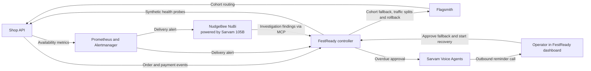

# FestReady

FestReady helps commerce teams keep orders moving when an outage occurs. It was built for India's festive shopping rush, when months of preparation come down to a few peak sales days. The same playbooks can help through Black Friday and everyday provider outages.

## How it works

1. **Investigate.** Prometheus detects a delivery availability drop. NudgeBee's NuBi uses Sarvam 105B to investigate and submits its findings to the controller over MCP. In the controller, using Sarvam's translation models, the RCA is visible to the user in any of the supported languages. 
2. **Limit the impact.** An operator reviews the findings and approves the fallback. Flagsmith moves only the affected city's customers to pickup.
3. **Recover gradually.** Synthetic probes check when the courier is healthy enough to start recovery. The operator starts the rollout, and the controller uses Flagsmith to restore delivery in steps. In the delivery demo, healthy steps advance automatically from 5% to 100%. A guardrail breach rolls traffic back to pickup automatically.
4. **Reach the operator.** If an actionable approval is overdue, FestReady can place a Sarvam Voice Agents call in the language configured on the playbook. The call gives the incident ID and directs the operator to the dashboard to review it.

## Try the demos

| Demo | How to run it |
| --- | --- |
| **Isolated payment sandbox** | With Docker and Compose running, use `make payment-demo-up` and open the dashboard at `http://127.0.0.1:3100`. Under **Playbooks**, create a playbook from a template and configure the payment alert, cohort, flag, and recovery rules. Under **Demo**, simulate a payment provider outage. The sandbox uses local fixtures, simulated payments, and operator findings. Run `make payment-demo-smoke` for an automated check and `make payment-demo-down` to stop the sandbox. |
| **Delivery rehearsal** | Follow the [demo runbook](docs/RUNBOOK.md) to run the KinD stack with Prometheus, NudgeBee, and Flagsmith. It covers setup, outage injection, rollback, and recovery. The rehearsal requires the configured integrations and a local `.env`. |
| **Sarvam approval calls** | Follow the [voice setup guide](infra/k8s/sarvam-voice.md) to connect a committed agent version and an outbound caller number. In the playbook wizard, enable **Approval reminder** and set a mobile number, wait time, and call language. |

Playbooks are customizable for different parts of the business. The wizard can suggest available Flagsmith flags, metrics, alerts, labels, and event fields, and run a readiness check before saving.

**Future scope:** Sarvam could fetch live incident details through controller APIs and allow a verified operator to approve fallback or recovery by phone.
