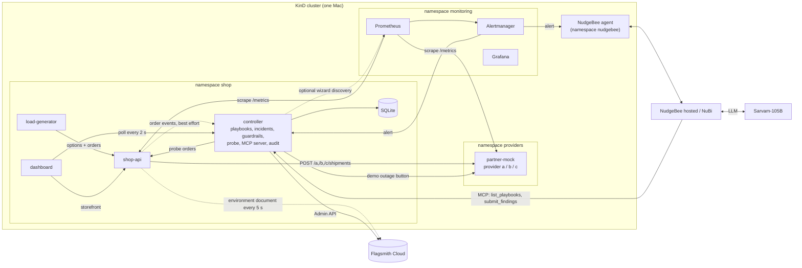
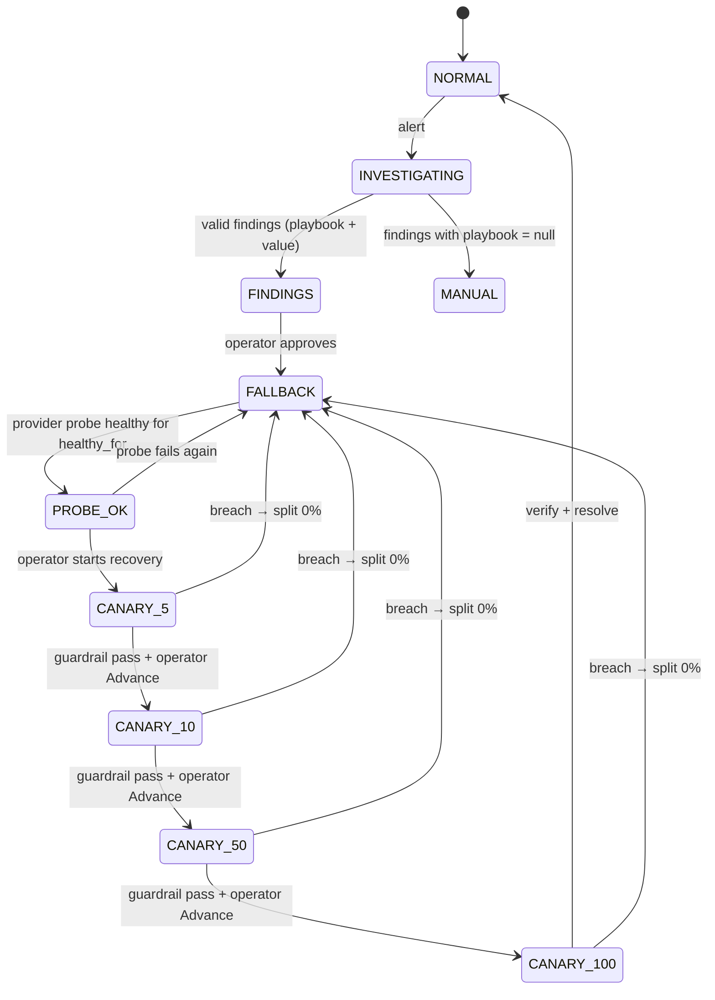

# Architecture — Festive-Rush Resilience Platform

> **Working title:** UtsavReady (name not final)
> **Team:** 0 Downtime · **Event:** WeMakeDevs × WeAreDevelopers Festive Hacks, Bengaluru, 25 Nov 2026
> **Sponsors integrated:** NudgeBee (NuBi), Sarvam AI, Flagsmith
> **Status:** Built and rehearsed end to end on 24 Nov (results in §15 and [`RUNBOOK.md`](RUNBOOK.md)). **All code is rebuilt from scratch on 25 Nov** in a new project from these docs (non-markdown setup files: [`FILES.md`](FILES.md)); Flagsmith, NudgeBee and Sarvam setup are kept. Items still marked **[VERIFY]** have not been run for real.
> **Companion docs:** [`CONTRACTS.md`](CONTRACTS.md) (interfaces both people code against) · [`WORK.md`](WORK.md) (who builds what, and when)
> **Owners:** Yashasvi (Person A: services + cluster + NudgeBee/Sarvam, Codex) · Nayan (Person B: controller + dashboard + Flagsmith, Claude Code)
> **Feature branch update (25 Nov, `demo/payment-failover`):** added an isolated payment-failover simulation, separate delivery and payment availability, and live discovery in the playbook wizard. See §4.1, §9.5 and §15.

---

## 1. One-line description

When a third-party dependency fails for one part of the business during the festive rush, NuBi works out what broke and whether it's ours or theirs. The platform turns that finding into a pre-approved, limited, reversible Flagsmith change for only the affected customers, then brings them back step by step with automatic rollback.

**Who it's for:** startups and growing digital businesses with no dedicated SRE team. During a festival, the two engineers may be away from their desks.

### 1.1 What the product is

NudgeBee can diagnose, and Flagsmith can switch a code path for a segment. Neither one decides **what is safe to change, for whom, and when it's safe to change back.** The controller is that safety layer:

1. **A playbook catalog, which is the contract between the AI and production.** NuBi can only choose from fallbacks the business has approved in advance. The controller validates every proposal, and the AI never touches Flagsmith directly.
2. **A limited blast radius.** Only the affected segment moves to the fallback.
3. **A guarded way back.** Exposure goes 5 → 10 → 50 → 100 in the demo. An operator starts recovery, each step is checked against event data, and rollback is automatic. The playbook controls whether advancing each step needs another operator click.
4. **Business context the AI doesn't have.** The controller sees individual orders and customers, so it can show orders and money lost and saved, detect on its own that the provider has recovered, and produce an evidence pack for the vendor.
5. **Readiness.** The dashboard checks playbooks against Flagsmith and recent events so a missing flag, segment or cohort signal is visible before an incident.

**Pitch:** _"NuBi tells you why. The controller takes the safe action and brings customers back gradually."_

---

## 2. Delivery demo scenario

**Business:** a fictional home-decor store with two ways to receive an order: **home delivery** and **in-store pickup**. It operates in **Bengaluru, Mumbai and Delhi**. Each city uses a different courier provider: **a** (Bengaluru), **b** (Mumbai) and **c** (Delhi).

| Phase                      | What happens                                                                                                                             | What the audience sees                                                                                                     |
| -------------------------- | ---------------------------------------------------------------------------------------------------------------------------------------- | -------------------------------------------------------------------------------------------------------------------------- |
| 1. Normal                  | All 3 cities offer delivery and pickup                                                                                                   | Orders succeed everywhere                                                                                                  |
| 2. Red herring             | shop-api is restarted (`make redherring`) about a minute before the fault                                                                | "We just deployed" becomes the obvious wrong guess                                                                         |
| 3. Outage                  | Provider b starts returning HTTP 500 (`make outage P=b`)                                                                                 | Mumbai delivery orders fail; BLR/DEL are fine                                                                              |
| 4. Investigate             | `DeliveryAvailabilityLow` fires (no city or provider label). Ticket INC-xxxx opens as **Investigating** with **no recommendation**       | Controller: "availability 67%; waiting for findings". NuBi investigates                                                    |
| 5. Findings                | NuBi calls `submit_findings` over MCP: playbook `city-delivery-fallback`, value `mumbai`, cause `external`                               | Incident page shows NuBi's own summary, the validated playbook and an **Approve** button                                   |
| 6. Isolate                 | Operator approves → Flagsmith fallback for the Mumbai segment only                                                                       | Mumbai shows **pickup only**; BLR/DEL still offer delivery. The alert resolves. "Orders saved by fallback" starts counting |
| 7. Provider recovers       | `make outage-clear P=b`. The controller's probe sees provider b healthy for the configured duration (60 seconds in the seed)               | "Provider b looks healthy. Start recovery?"                                                                                |
| 8. Gradual recovery        | The operator starts recovery. The delivery seed advances **5% → 10% → 50% → 100%** as each guardrail passes.                                 | Mumbai delivery share rises in steps                                                                                       |
| 9. (Wow moment) Regression | Outage injected again during the 10% step                                                                                                | Controller detects the breach and sets the split to 0% automatically. The same ticket goes back to Mitigated               |
| 10. Close                  | Recover to 100%, export the provider evidence pack, close with a note                                                                    | Time to mitigate, time to recover, orders and ₹ saved                                                                      |

**Why pickup-only is a good fallback:** it's graceful degradation. The business keeps taking orders and doesn't need a second vendor.

**Why a third-party outage:** we can't fix someone else's outage, so a fallback is the only option. It also gives NuBi a real question to answer: is this ours or theirs?

---

## 3. Scope

### In scope (P0/P1)

- shop-api with a fallback code path controlled by a Flagsmith flag, evaluated per customer with the `city` trait.
- partner-mock simulating three external providers, with a demo-only outage switch.
- Prometheus metrics and structured logs that include `city` and `provider`.
- NudgeBee agent in the cluster, with NuBi investigation powered by Sarvam-105B (BYOM).
- NuBi findings delivered to the controller over **MCP** (`list_playbooks`, `submit_findings`), plus an operator form as the safety net (§7.3).
- Flagsmith segment isolation, percentage-based recovery, and automatic rollback driven by our controller.
- Incidents tracked as tickets with a lifecycle and their own page (§9.4).
- General playbook format, **stored in the controller's SQLite database** and seeded from a YAML file (§9.3).
- Provider probe, business impact and provider evidence pack (§9.6).
- A dashboard with storefront, ops console, playbook creation and editing, readiness, and audit (§9.5).
- On `demo/payment-failover`, an isolated payment simulation that uses the same controller and playbook engine (§4.1).

### Stretch (P2)

- Sarvam-written win-back messages to affected customers in their language, sent only to the affected segment.
- Readiness drill: run the whole scenario against a separate Flagsmith environment, grade NuBi's diagnosis against the injected fault, and issue a pass/fail scorecard.

### Non-goals

- Real payments, real couriers, multi-tenant SaaS, voice control.
- Self-hosted NudgeBee control plane (use the hosted one).
- AI taking actions without approval. Initial failover always needs a human click.
- Claims of zero downtime. We only switch between paths that already exist and have been tested.
- Playbook review through Git pull requests (playbooks live in the controller database).

---

## 4. High-level architecture



**Ownership:** Yashasvi builds `shop-api`, `partner-mock`, `load-generator`, the cluster, monitoring, and the NudgeBee/Sarvam setup. Nayan builds the `controller`, the `dashboard`, and the Flagsmith setup. Interfaces are in [`CONTRACTS.md`](CONTRACTS.md).

### 4.1 Isolated payment failover

[`infra/payment-demo/compose.yaml`](../infra/payment-demo/compose.yaml) runs the dashboard, shop-api, controller, courier mock, and `payment-demo` fixture on a private Compose network. Only the dashboard is published on loopback at `127.0.0.1:3100` by default. The stack starts with an empty playbook store and uses local simulator keys. It exercises the controller without changing the rehearsal cluster or using hosted Flagsmith, NudgeBee, or real payment accounts.

1. **Normal routing.** On `/payments`, the operator submits a synthetic payment with a preferred provider (`alpha`, `beta` or `gamma`). That preference defines the cohort. With `PAYMENT_DEMO_URL` configured, shop-api reads the routing decision from the fixture and attempts the preferred provider while primary routing is enabled.
2. **Failure and approval.** An authenticated outage switch makes the chosen mock return `503 PROVIDER_UNAVAILABLE`. A failed primary attempt by a non-probe customer emits a throttled, simulated `PaymentAvailabilityLow` alert to the controller. The operator submits findings marked `source: operator` and approves the cohort-specific change. The fixture serves the Flagsmith Admin API paths the controller already uses, via `FLAGSMITH_ADMIN_URL`, so the same write and read-back code exercises `payment_primary_enabled` and the `payment-{value}-fallback` / `payment-{value}-recovery` segments.
3. **Fallback and recovery.** Only the approved cohort moves to backups. Shop-api orders the other providers deterministically per customer and tries another only after an explicit `503 PROVIDER_UNAVAILABLE`. An ambiguous response or timeout ends the attempt. The `pay-probe-{value}` identity always reaches its matching primary. The payment playbook requires operator advancement (`auto_advance: false`) and its guardrail counts primary payment events for the affected cohort. A canary breach or renewed firing alert can roll the split back automatically.

Shop-api posts payment events to the existing `/internal/orders` ingestion route. The playbook maps `paymentCohort`, `paymentCustomer`, `paymentOutcome`, and `paymentRoute` into the shared engine. Overview reports five-minute availability by configured playbook dimension. Delivery counts eligible delivery attempts, while payments count primary and fallback attempts so a successful backup contributes to payment availability. Both exclude the playbook's reserved probes.

Run the sandbox with `make payment-demo-up`, exercise it in a disposable project with `make payment-demo-smoke`, and stop it with `make payment-demo-down`.

---

## 5. Components

Exact endpoints, payloads, ports and env vars live in [`CONTRACTS.md`](CONTRACTS.md). This section explains intent.

### 5.1 `shop-api` (Bun/TypeScript)

- `GET /api/options?customerId=` returns the fulfilment options for this customer: `["delivery","pickup"]` or `["pickup"]`.
- `POST /api/orders` creates a synthetic order. For `delivery`, it calls the customer's city's provider at partner-mock directly. There is no separate courier service.
- **City comes from the customer ID** (`cust-mum-0142` → mumbai). There's no database. The client never sends `city`.
- **City → provider** is a constant in shop-api: bengaluru → a, mumbai → b, delhi → c.
- Evaluates Flagsmith as an **identity** (`customerId`) with trait `city`, in **local evaluation** mode with a 5-second refresh (§8). There is no Flagsmith call per order.
- If `home_delivery_enabled` is off, delivery isn't offered, and a delivery request made anyway is rejected with a clear message.
- Sends each order (customer, city, provider, mode, flag value, outcome, amount, latency) to the controller as a best-effort event, and exposes the same data as metrics. If the controller is down, orders still work.

### 5.2 `partner-mock`

- Simulates three external courier providers at `/a`, `/b` and `/c`, in its own namespace `providers` so it reads as external.
- Returns `200` normally. During an outage on a provider, that provider returns `500 PROVIDER_UNAVAILABLE`.
- Outage state is in memory, set by `POST /admin/outage` (admin secret). There is no city logic and there are no API keys.

### 5.3 `load-generator`

- A finite, rate-controlled stream of synthetic orders (default 5 per second), as a plain Bun script with no dependencies.
- About **500 stable customer IDs per city**, so a 5% split has enough canary members (about 25).
- Mix: about 70% delivery attempts and 30% pickup. It asks `/api/options` first and only attempts delivery when it's offered, like a real customer. Each order carries a synthetic `amount` (cart total in ₹).

### 5.4 `controller`

A **generic engine**. It knows nothing about cities, couriers or this store; everything specific comes from a playbook (§9.3). If `mumbai`, `city` or `home_delivery_enabled` appears in controller code, that's a bug.

- **Holds (SQLite):** playbooks, incident tickets (§9.4), findings, order events, the recovery state machine (§9.1), guardrail state, probe results and the audit log.
- **Receives:**
  - The Alertmanager webhook, which opens an incident in **Investigating** or reopens the open one.
  - NuBi's findings over MCP, or through the operator form.
  - Order events from shop-api.
- **Does not diagnose.** Before findings arrive, it knows only the overall availability. It has no per-segment breakdown and makes no recommendation (§7.2).
- **Calls:**
  - The Flagsmith Admin API (server-side token only).
  - shop-api, for probe orders.
  - partner-mock, for the demo outage button.
  - Optionally Prometheus for wizard discovery.
- **Runs two loops:** the guardrail loop handles automatic rollback and opted-in step advancement after recovery starts. The provider probe loop detects when recovery can start.

### 5.5 `dashboard` (Next.js)

- **Every ops panel reads from the controller API.** The browser never talks to Prometheus, Flagsmith or partner-mock. Write actions go through a Next.js server route that adds the admin secret, so the secret never reaches the browser.
- **Live updates:** panels poll the controller every 2 seconds. No websockets.
- **Charts:** simple CSS bars. For real metric graphs, link out to Grafana.
- **Names come from the playbook**, not from hard-coded text.
- **Pages:**
  - **Overview:** separate availability by playbook dimension, the incident list, and playbook readiness. No per-cohort breakdown before findings exist.
  - **Incident page** `/incidents/INC-xxxx`:
    - status, a link to the NuBi investigation, and NuBi's summary (verbatim);
    - the validated playbook with **Approve**, and the findings form (safety net);
    - the recovery panel: split %, observed share, samples, guardrail result, **Advance** (enabled only when the guardrail passes) and **Rollback**;
    - business impact, the provider probe, the timeline, evidence export, and **Close** (requires a note).
  - **Playbooks:** list with Ready/Broken status and a wizard to create from scratch, start from a generic template, or edit a saved playbook.
  - **Storefront:** pick a demo customer from a fixed list of IDs per city, see the options, place an order.
  - **Demo controls:** start or clear a provider outage (requires auth).
  - **Payment simulation:** run synthetic payments and simulate mock-provider outages when enabled (§4.1).
  - **Audit log.**

A clickable mockup was shared separately (`portal-mockup.html`). It's a reference, not code.

---

## 6. Telemetry contract (what NuBi and the controller depend on)

Exact names and types are fixed in [`CONTRACTS.md`](CONTRACTS.md) §4.

### Metrics (Prometheus)

```text
shop_orders_total{city, mode, result}                 # result=success|error|rejected  → the alert
courier_dispatch_total{city, provider, status}        # status=200|500|timeout          → NuBi's drill-down
courier_dispatch_duration_seconds_bucket{city, provider, le}
shop_delivery_flag_evaluations_total{city, value}     # value=true|false                → fallback taking effect
```

- `city` and `provider` have 3 values each, so cardinality is safe. **Never** use customer or order IDs as labels.

### Logs (JSON to stdout)

```json
{
  "ts": "2026-11-25T11:03:00+05:30",
  "service": "shop-api",
  "level": "error",
  "request_id": "r-123",
  "order_id": "o-456",
  "city": "mumbai",
  "provider": "b",
  "status": 500,
  "error": "PROVIDER_UNAVAILABLE",
  "synthetic": true
}
```

partner-mock logs each request with `provider` and `status` too, which gives NuBi evidence from the provider's side.

### Alert (PrometheusRule)

- `DeliveryAvailabilityLow`: the delivery error rate from `shop_orders_total` is above 5% for 1 minute, with **no city or provider label**.
- Deliberate: NuBi has to break the errors down by provider and city on its own.
- `rejected` doesn't count as an error, so once the fallback is on, the alert **resolves on its own**. That's visible proof the mitigation worked.
- Alertmanager sends it to **two** receivers through child routes with `continue: true`: the NudgeBee agent (`http://nudgebee-agent-runner.nudgebee.svc/api/alerts`, verified) and the controller.

---

## 7. NudgeBee + Sarvam: the diagnosis

### 7.1 What NuBi has to work out

| Question        | Evidence on KinD                                                                                                                                                                                              | Why it matters                                                                    |
| --------------- | ------------------------------------------------------------------------------------------------------------------------------------------------------------------------------------------------------------- | --------------------------------------------------------------------------------- |
| Where?          | `courier_dispatch_total` by `provider` and `status`: only provider b / city mumbai has 500s                                                                                                                   | Picks the segment to isolate                                                      |
| Ours or theirs? | The same shop-api pods serve providers a and c successfully; pods are healthy; the only recent change is the shop-api restart (red herring), which a and c survived; the provider returned 500, not a timeout | Theirs → a fallback is the right action. Ours → roll back our change; no fallback |
| How bad?        | Failing orders and customers, and since when                                                                                                                                                                  | Urgency                                                                           |
| What next?      | Picks a playbook from the catalog with `list_playbooks`                                                                                                                                                       | The only route to an Approve button                                               |

Data sources on KinD: Prometheus metrics (yes), Kubernetes events and state (yes), pod logs (verified 24 Nov: NuBi cited shop-api and partner-mock log lines). eBPF/L7 tracing is unavailable, because NudgeBee disables its eBPF node agent on KinD.

**Pitch point:** Kubernetes health checks completely miss this failure, because every pod is healthy and only one city's business flow is broken.

### 7.2 Why NuBi is required, not optional

The controller does **not** diagnose. On an alert, it opens an Investigating ticket that shows only overall availability. It doesn't know which segment broke or why, so it can't recommend anything, and **Approve stays disabled until findings arrive.** This isn't an artificial restriction. A generic controller can't search every possible dimension (city, provider, bank, app version); finding the dimension is open-ended, which is NuBi's job. Once findings name the dimension and value, the controller measures that segment for guardrails and business impact.

### 7.3 How findings reach the controller: MCP (decided)

The controller runs an **MCP server** with two tools (CONTRACTS.md §3.5):

- `list_playbooks()` returns the catalog: id, description, dimension, allowed values, and cause.
- `submit_findings({playbook, value, cause, summary, evidence})` is called once the investigation is done. `playbook: null` means "no playbook fits", for example when the cause is our own change.

NudgeBee connects external MCP servers so their tools become available to NuBi's AI tasks, either directly over HTTP or proxied through the in-cluster agent. Verified 24 Nov: the MCP server shows up in NuBi, Sarvam calls its tools, and NudgeBee reaches the in-cluster controller through the **proxy agent** ("forager", a separate install from the cluster agent; connection mode _Proxy Agent_).

The tool descriptions do most of the prompting. NuBi's built-in alert investigation does **not** call MCP tools on its own. What works (verified 24 Nov): an **Account Context** for the cluster account with the rule "finish every DeliveryAvailabilityLow investigation with `submit_findings`", plus a NudgeBee **automation** (event trigger on `DeliveryAvailabilityLow` → _Nubi_ step). Exact text: `infra/nudgebee/nubi-config.md`, `infra/nudgebee/automation.json`. The _Event Investigate_ step alone is not enough: repeat alerts are grouped as duplicates and get the cached analysis.

The controller **validates** every submission against the catalog:

- the playbook must exist;
- the value must be in its allowed values;
- the cause must match;
- the incident's alert must be in the playbook's `match.alerts`.

An invalid submission is rejected with the reason, so NuBi can correct it. With `playbook: null`, the ticket shows NuBi's summary and "No playbook matches; handle manually", with no Approve button.

**Safety net:** the incident page has a findings form (playbook and value as dropdowns from the same catalog, NuBi's summary pasted, plus its link). It posts to the same endpoint with the same validation. If NuBi itself fails on stage, the operator investigates in Grafana and submits with `source: "operator"`, and we **say so** on stage.

**Never write, paraphrase or simulate NuBi output.** The summary shown is NuBi's own text.

### 7.4 Sarvam as NuBi's LLM

- NudgeBee → Integrations → LLM → custom provider. Model `sarvam-105b`, Bearer auth. **Must go through the shim** `http://sarvam-shim.festive-shim.svc/v1` (`infra/nudgebee/sarvam-shim.yaml`): NudgeBee sends `max_completion_tokens`, Sarvam ignores it and defaults to 2,048 output tokens, and the reasoning model spends all of them thinking, so every reply is empty. The shim rewrites it to `max_tokens: 16384`.
- Verification ladder:
  1. Plain chat-completion with curl.
  2. NudgeBee "Test Connection".
  3. A simple NuBi question.
  4. **A NuBi investigation that requires tool calls** (PromQL, kubectl-style lookups, and our MCP tools). This is the critical gate.
  5. Full investigation of the injected outage, ending in `submit_findings`.
- If step 4 fails: say openly that Sarvam BYOM is configured but agent tool use isn't compatible, or try NudgeBee's LLM Gateway. Use the operator form, labelled as such. **Never fake NuBi output.**

---

## 8. Flagsmith design

### Flag

| Flag                    | Type    | Default |
| ----------------------- | ------- | ------- |
| `home_delivery_enabled` | boolean | on      |

### Segments (created once, per value; highest priority first)

| Priority | Segment               | Rule                                 | Override |
| -------- | --------------------- | ------------------------------------ | -------- |
| 1        | `{value}-recovery`    | `city == {value}` AND `% Split <= N` | on       |
| 2        | `{value}-fallback`    | `city == {value}`                    | off      |
| —        | (environment default) | everyone else                        | on       |

That's 6 segments for the demo (3 cities × 2). Only Mumbai is exercised, but all three keep the setup honest.

### How shop-api evaluates (local evaluation)

- At startup and then every 5 seconds, the SDK downloads the environment document (flags, segments, rules, splits, overrides). Each `getIdentityFlags(customerId, { city })` is evaluated **in memory**, with no network call per order.
- The code is identical for every customer; the `city` trait decides which segment matches. Segments are checked in priority order and the first match wins.
- The **% split** is computed by the SDK: each identity gets a stable hash bucket. We write none of that code.
- If Flagsmith is unreachable, shop-api keeps serving from its last cached document.

### Lifecycle

- Approve: turn on the `{value}-fallback` override; N stays 0.
- Recovery: the controller **edits N on the one `{value}-recovery` segment**: 5 → 10 → 50 → 100. Raising N keeps the identities already inside the split (documented by Flagsmith), so canary customers stay on delivery from one step to the next.
- Rollback: set N=0.
- Close at 100%: turn off the fallback override and reset N to 0.

**Alternative if editing segment rules through the API is awkward:** pre-create per-step segments (`-5`, `-10`, `-50`, `-100`) and toggle overrides. Each segment picks a different random group, so canary groups don't carry over between steps. Use only if needed.

### Key facts and caveats

- The split buckets **identities, not requests**, so the dashboard shows the **observed** share of orders too.
- The `city` trait is set by shop-api from the customer ID and never comes from the client.
- The Admin API token stays only in the controller.
- Verified on 24 Nov (checks 7–9, 11): local evaluation, priority order, a split inside Mumbai only, members kept as N rises, ~7 s propagation. The calls are in `CONTRACTS.md` §5.
- The fallback override always exists. Approve flips its `enabled` value (v2 feature versioning) instead of creating it.

---

## 9. Recovery controller

### 9.1 State machine



Steps come from the playbook. The diagram shows manual advancement, which the payment simulation uses. The delivery seed opts into automatic advancement after the operator starts recovery.

### 9.2 Guardrails (demo values, not production SLOs)

- **Canary cohort:** events for the affected value that match the playbook's `canary_filter` while recovery is active. Reserved probe events are excluded.
- **Minimum sample:** `min_samples` per step, set to 10 in the demo. Below that, wait.
- **Breach:** error rate above `max_error_rate` (5%), OR `max_consecutive_errors` (3) errors in a row.
- **Observation window:** `window` is 20 s per demo step, with `cooldown_after_rollback` set to 60 s.
- **Rollback and advance.** The controller rolls back on a breach. Starting recovery always requires the operator. The guardrail must pass at each step. Then the operator advances unless the playbook sets `recovery.auto_advance: true`.
- Flag writes include a read-back. The audit records the actor, before and after state, and result.

### 9.3 Playbook format

Playbooks are stored in the controller's SQLite database. On first start with an empty database, the controller imports YAML from `PLAYBOOK_DIR`, which defaults to `apps/controller/playbooks/` in the project layout. After that, the database is the source of truth and playbooks are created and edited through the API and wizard. The base schema and validation rules are in `CONTRACTS.md` §8.

```yaml
id: city-delivery-fallback
version: 1
owner: delivery-team
description: >
  Home delivery fails for one city because that city's courier provider is failing.
  Fallback: disable home delivery for that city; in-store pickup keeps working.
match: { alerts: [DeliveryAvailabilityLow], cause: external }
dimension:
  { name: city, trait: city, label: city, values: [bengaluru, mumbai, delhi] }
flag:
  key: home_delivery_enabled
  normal: { enabled: true }
  fallback: { enabled: false }
segments: { fallback: "{value}-fallback", recovery: "{value}-recovery" }
recovery:
  method: split
  steps: [5, 10, 50, 100]
  auto_advance: true
  guardrail:
    {
      min_samples: 10,
      max_error_rate: 0.05,
      max_consecutive_errors: 3,
      window: 20s,
    }
  cooldown_after_rollback: 60s
events:
  dimension_field: city
  identity_field: customerId
  outcome_field: outcome
  amount_field: amount
  canary_filter: { mode: delivery }
health: # optional PromQL alternative to events; [VERIFY] against real metrics
  errors: sum(rate(courier_dispatch_total{city="{value}",status!="200"}[1m]))
  total: sum(rate(courier_dispatch_total{city="{value}"}[1m]))
probe:
  every: 10s
  healthy_for: 60s
  identities:
    { bengaluru: cust-blr-0001, mumbai: cust-mum-0001, delhi: cust-del-0001 }
  request:
    {
      method: POST,
      url: "${SHOP_URL}/api/orders",
      body: { customerId: "{probe_identity}", mode: delivery, synthetic: true },
    }
  expect: { healthy: { status: 201 }, fallback_active: { status: 409 } }
```

Flag, segment, metric, and event-field names come from the playbook. The payment simulation uses the same engine with the preferred provider as the dimension and a boolean flag that enables primary routing (§4.1). Playbooks can use `{value}` and `{probe_identity}`. The API restricts network-bound templates to the configured shop probe endpoints (§9.5).

**Platform safety rules no playbook can change:**

- Initial fallback and the start of recovery require operator approval.
- Later steps require a passing guardrail regardless of the advancement setting.
- Rollback is always automatic.
- `min_samples` ≥ 10.
- Steps must increase, end at 100, and start at ≤ 10.
- `max_error_rate` ≤ 0.2.

### 9.4 Incidents as tickets

Each incident is a ticket with an ID, an owner and **its own page** (`/incidents/INC-xxxx`). The state machine in §9.1 runs inside a ticket.

| Ticket status | Meaning                                                   | Recovery state                  |
| ------------- | --------------------------------------------------------- | ------------------------------- |
| Investigating | Alert received, waiting for findings                      | INVESTIGATING, FINDINGS, MANUAL |
| Mitigated     | Fallback applied; affected customers are on the safe path | FALLBACK, PROBE_OK              |
| Recovering    | Split rising step by step                                 | CANARY_*                        |
| Resolved      | 100% back, verified                                       | NORMAL                          |
| Closed        | A person wrote the closing note                           | NORMAL                          |

- **Fields:** `INC-0042`, title, playbook, dimension value, status, owner, findings (source, summary, NuBi link), timestamps for each status, closing note. Audit rows carry `incident_id`.
- **Deduplication:** the alert maps to the open incident. A regression **reopens the same ticket** (Recovering → Mitigated); it never creates a second one.
- **Numbers per ticket:** time to mitigate, time to recover, orders failed, orders saved by the fallback, ₹ at risk per minute, customers affected.

### 9.5 Playbook management and discovery

- **API:** list, read, create, update, and run a readiness check (CONTRACTS.md §3.4). Every write is validated (§9.3 safety rules, schema) and audited.
- **Readiness check** (the Ready / Broken badge):
  - the flag exists in Flagsmith;
  - both segments exist for every value;
  - recent non-probe events include every configured value;
  - no value seen in the data is missing from `dimension.values` (e.g. `city="pune"` appears).
- **Wizard.** Start with a blank draft or a generic template to pause a route or enable a fallback route. The owner defaults to the signed-in user. The wizard can derive an ID from a selected alert, add discovered cohort values, fill matching segment templates, and prefill editable recovery and probe settings.
- **Discovery.** The authenticated catalog combines Flagsmith flag keys and segment names, recent Prometheus metric and label names, configured and observed alert names, and field names from recent events. Selecting a Prometheus label loads recent values, optionally narrowed to a metric. Suggestions remain editable, and manual entry works when an upstream is unavailable. The helper returns event field names only.
- **Before saving.** The operator can run a synthetic test probe and preview readiness. API-managed probes can POST only to the configured `SHOP_URL` order or payment path, with redirects rejected and no environment expansion in the body. Probe identities are supplied by the operator. Optional PromQL selectors can be authored and saved in the wizard. Runtime readiness and guardrails use events.

### 9.6 Business features (the controller sees orders, not just systems)

- **Provider probe:** while in the fallback, the controller sends the playbook's probe request every `every` seconds with the reserved probe identity. After `healthy_for` of passing probes, it says "ready to start recovery", so we don't wait for the third party to announce the fix. If a probe fails during PROBE_OK, the state goes back to FALLBACK.
- **Business impact:** from order events with `amount`:
  - orders failed and their value;
  - orders saved by the fallback (customers in the segment who ordered pickup);
  - ₹ at risk per minute if left unmitigated;
  - customers affected.
- **Provider evidence pack:** an export of failed attempts for the segment (time range, count, status codes, customers affected) to escalate to the vendor or claim SLA credits.

---

## 10. Fault injection

| Fault                    | How                                                                                         | Visible as                                                 |
| ------------------------ | ------------------------------------------------------------------------------------------- | ---------------------------------------------------------- |
| Red herring              | `make redherring` (rollout restart of shop-api) about a minute before the outage            | A recent deploy event for NuBi to rule out                 |
| Provider b outage        | `make outage P=b`, or the dashboard demo button (controller → partner-mock `/admin/outage`) | 500s for provider=b / city=mumbai; partner-mock logs       |
| Provider fixed           | `make outage-clear P=b`                                                                     | Probe goes healthy; Mumbai 200s again for canary customers |
| Regression during canary | `make outage P=b` again                                                                     | Canary breach → automatic rollback                         |

Delivery fault controls target `partner-mock`. The isolated payment outage control targets `payment-demo`. Both use server-side admin authentication.

---

## 11. Infrastructure and secrets

- **Cluster:** KinD on one Mac. Namespaces: `shop`, `providers`, `monitoring`, `nudgebee`.
- **Monitoring:** `kube-prometheus-stack` Helm chart (Prometheus, Alertmanager, kube-state-metrics, Grafana), with a `ServiceMonitor` for shop-api and partner-mock. No Loki needed: NuBi reads pod logs through the agent (verified).
- **NudgeBee ↔ controller MCP:** reached through the NudgeBee proxy agent (forager) in namespace `nudgebee` (verified).
- **Network:** hosted NudgeBee and Flagsmith need outbound internet. Bring a mobile hotspot.
- **Secrets** (local `.env` / Kubernetes Secrets, never committed; full list per service in `CONTRACTS.md` §7):

```text
FLAGSMITH_SERVER_KEY=          # shop-api SDK, server-side
FLAGSMITH_MGMT_TOKEN=          # controller only
FLAGSMITH_PROJECT_ID= / FLAGSMITH_ENV_ID= / FLAGSMITH_ENV_KEY=
SARVAM_API_KEY=                # configured inside NudgeBee
ADMIN_SECRET=                  # controller, dashboard server routes, partner-mock
```

### 11.1 macOS setup (both of us use Macs)

- **Tools:** `brew install kind kubectl helm jq oven-sh/bun/bun` plus a Docker runtime (Docker Desktop or OrbStack).
- **Resources:** give the Docker VM at least **8 GB RAM and 4 CPUs**.
- **Apple Silicon:** our images build as arm64. Third-party images must have arm64 builds: The NudgeBee agent and forager images run on arm64 (verified on colima).
- **Getting images into KinD:** `docker build -t <name>:dev`, then `kind load docker-image <name>:dev`. Use `imagePullPolicy: IfNotPresent`.
- **Reaching the cluster from the Mac:** KinD `extraPortMappings` + NodePorts (`CONTRACTS.md` §1). Use `kubectl port-forward` only for debugging.
- **Avoid ports 5000 and 7000** (AirPlay Receiver).
- **One demo Mac, one backup Mac.** On stage, run `caffeinate -dims`.
- **Integrate through `git pull`, not the network.** Share `.env` by AirDrop, never through git.

---

## 12. Repository layout

```text
repo/
  apps/
    dashboard/        # Next.js storefront + ops console + playbooks
    controller/       # engine, Flagsmith admin client, incidents, MCP server, audit (SQLite)
      playbooks/      # seed YAML, imported into SQLite on first start
  services/
    shop-api/
    partner-mock/
    load-generator/
    payment-demo/     # local payment provider and Flagsmith-compatible fixture
  infra/
    kind/             # cluster config (extraPortMappings)
    k8s/              # deployments, services, namespaces, secrets templates
    monitoring/       # helm values, ServiceMonitors, PrometheusRule, Alertmanager routes
    payment-demo/     # isolated Compose stack and smoke test
    nudgebee/         # tunnels.sh, install-agents.sh, sarvam-shim.yaml, nubi-config.md, automation.json (created verbatim from docs/FILES.md)
  docs/
    ARCHITECTURE.md
    CONTRACTS.md
    WORK.md           # 25 Nov plan + prompts
    RUNBOOK.md        # how to run, reset and rescue the demo
    FILES.md          # exact contents of the non-markdown setup files
    demo-script.md    # written on 25 Nov (B8)
  AGENTS.md
  CLAUDE.md
  Makefile            # up, down, images, deploy, load-start, load-stop, outage, outage-clear, redherring, monitoring
  .env.example        # from docs/FILES.md
  .gitignore          # from docs/FILES.md
  .env                # AirDrop only, never committed
```

---

## 13. Validation checks (all done on 24 Nov; results in CONTRACTS.md §5, this doc §7 and RUNBOOK.md)

Who does which check is in [`WORK.md`](WORK.md).

| #   | Check                              | Pass condition                                                                                                                                                                                                              |
| --- | ---------------------------------- | --------------------------------------------------------------------------------------------------------------------------------------------------------------------------------------------------------------------------- |
| 1   | Sarvam chat completion with curl   | 200 response from `sarvam-105b`                                                                                                                                                                                             |
| 2   | Sarvam tool calling with curl      | Model returns a valid tool call                                                                                                                                                                                             |
| 3   | NudgeBee custom LLM → Sarvam       | Test Connection passes; NuBi answers                                                                                                                                                                                        |
| 4   | NudgeBee agent on KinD (on a Mac)  | Cluster shows up; events and metrics visible; agent images run on arm64                                                                                                                                                     |
| 5   | Alert ingestion                    | A test Alertmanager alert reaches NudgeBee through the in-cluster agent-runner URL                                                                                                                                          |
| 6   | NuBi tool use with Sarvam          | NuBi runs a query or lookup during an investigation                                                                                                                                                                         |
| 7   | Flagsmith segments                 | Test identities with `city` evaluate correctly; priority order works; split applies within Mumbai only; raising N keeps existing members                                                                                    |
| 8   | Flagsmith Admin API                | Exact calls to edit a segment's % split, toggle a segment override, read back, and set a flag value, recorded in `CONTRACTS.md` §5                                                                                          |
| 9   | Flag propagation                   | In local-evaluation mode, a change reaches the server SDK within a few seconds                                                                                                                                              |
| 10  | Rules                              | Confirm that credential/API testing before the event is allowed                                                                                                                                                             |
| 11  | Flagsmith request quota            | Our plan's monthly limit is known and the load rate fits it                                                                                                                                                                 |
| 12  | **NudgeBee ↔ MCP (critical path)** | A custom MCP server (any test server) shows up in NuBi; Sarvam calls one of its tools; hosted NuBi reaches an in-cluster server through the agent proxy; a custom instruction can be set for alert-triggered investigations |

---

## 14. Risks and contingencies

| Risk                                                        | Fallback                                                                                                                                           |
| ----------------------------------------------------------- | -------------------------------------------------------------------------------------------------------------------------------------------------- |
| Sarvam fails NuBi tool calling                              | Try the NudgeBee LLM Gateway; otherwise state the limitation honestly and use the operator findings form (`source: operator`)                      |
| NuBi can't use our MCP server, or can't reach it            | Tunnel to the controller; otherwise the operator copies NuBi's findings into the form (NuBi's text, its link)                                      |
| NuBi can't see logs on KinD                                 | Rely on metrics with `provider` labels + Kubernetes events; add Loki                                                                               |
| Flagsmith segment-rule API unclear                          | Pre-made per-step segments and toggle overrides                                                                                                    |
| Flagsmith request quota runs out                            | Local evaluation (§8); lower the load rate; stop the load generator when not testing                                                               |
| Too few canary samples                                      | More customer IDs or a higher load rate; show sample counts in the UI                                                                              |
| NudgeBee agent has no arm64 images                          | Run it under emulation if possible; otherwise demo the operator form and say so                                                                    |
| Mac runs out of memory                                      | Raise the Docker VM limit; turn off Grafana and node-exporter in the Helm values                                                                   |
| Venue Wi-Fi fails                                           | Hotspot; record a working demo video by about 2:30 PM                                                                                              |
| Running out of time                                         | Priority list in `WORK.md` ("Cutting scope")                                                                                                       |
| Sarvam replies empty inside NudgeBee (`stopReason: length`) | Keep the provider pointed at the shim (§7.4); after any NudgeBee Helm upgrade re-check the shim endpoint and `LLM_MODEL_MAX_OUTPUT_TOKENS`         |
| NuBi investigates but never calls `submit_findings`         | Account Context + automation (§7.3); otherwise the operator form, said out loud                                                                    |
| Controller restarted mid-demo                               | Its DB is `emptyDir`: all incidents vanish (Overview shows none). Don't restart it during the demo; restart only as the deliberate reset           |
| Our own changes look like the cause to NuBi                 | Don't scale or restart shop-api/load-generator right before the outage; do it several minutes earlier (`make redherring` is the only intended one) |
| NudgeBee tunnels drop                                       | `infra/nudgebee/tunnels.sh` reconnects; run it in its own terminal, not inside an agent session (2 h limit)                                        |
| Docker not running after a reboot                           | `colima start` before any `make`                                                                                                                   |

---

## 15. Honest status labels (use in README and pitch)

- **Implemented and verified:** works end to end, with evidence.
- **Implemented with simulated input:** the fault is injected; the platform actions are real.
- **Partially integrated:** e.g. alert ingestion works but NuBi's tool calls don't.
- **Proposed:** design or pitch work without a working implementation.

**Delivery rehearsal on 24 Nov:**

- _Implemented and verified:_ provider outage → `DeliveryAvailabilityLow` alert → controller incident and NudgeBee event; NudgeBee automation → NuBi (Sarvam) investigates → `submit_findings` over MCP, no human input (~4 min); operator Approve → Flagsmith fallback for Mumbai only; probe; operator-approved canary 5/10/50/100%; automatic rollback on breach (8 s at 50%) and on alert re-fire; cooldown; resolve and close; impact numbers; evidence JSON/CSV; audit of every action with Flagsmith read-back.
- _Implemented with simulated input:_ the outage itself (partner-mock switch) and all orders (load generator).

**Feature branch verification on 25 Nov:**

- _Implemented with simulated input on `demo/payment-failover`:_ the isolated payment fixture, synthetic alert, operator findings and approval, cohort-scoped fallback, and a recovered primary probe. The Compose smoke test exercises this path, including an unavailable backup and a healthy unrelated cohort. Controller tests cover payment canary filtering and automatic rollback behavior.
- _Verified on `demo/payment-failover` against local fixtures:_ separate availability metrics, generic playbook creation, live discovery, synthetic probe, readiness, and save. The wizard flow was exercised in Chrome. Runtime guardrails and readiness use events. PromQL query fields are authorable, and live PromQL health and value-type failover remain unverified.
- _Proposed:_ readiness drills, Sarvam win-back messages, and multi-tenant operation.

Never present a hand-written diagnosis as NuBi output. Findings entered through the form are labelled `source: operator`. Never call a step "automatic" if a human clicked it.

---

## 16. Decisions and open questions

Decided:

1. Local evaluation, ~5 s refresh (§8), pending checks 9 and 11.
2. An operator starts recovery. Each later step advances manually unless the playbook opts into automatic advancement. Rollback is automatic (§9.2).
3. A separate page per incident (§9.4).
4. Yashasvi = A (business + cluster), Nayan = B (control side) ([`WORK.md`](WORK.md)).
5. The whole project is built on 24 Nov; the event day is for running, polishing, recording and pitching ([`WORK.md`](WORK.md)).
6. The fault is a third-party provider outage, with three providers, one per city (§2).
7. courier-service is merged into shop-api (§5.1).
8. NuBi findings come over MCP; the controller doesn't diagnose; Approve requires findings (§7.2, §7.3).
9. Recovery edits N on one recovery segment (§8).
10. Playbooks live in the controller database. The delivery cluster starts from a YAML seed and the payment sandbox starts with an empty catalog (§4.1, §9.3).

Open:

1. Does the NudgeBee agent proxy reach an in-cluster MCP server, or do we need a tunnel? (check 12)
2. Can we set a custom instruction for alert-triggered NuBi investigations? (check 12)
3. Sarvam win-back messages: build or only describe?
4. Readiness drills: build, or pitch as the product's direction?
